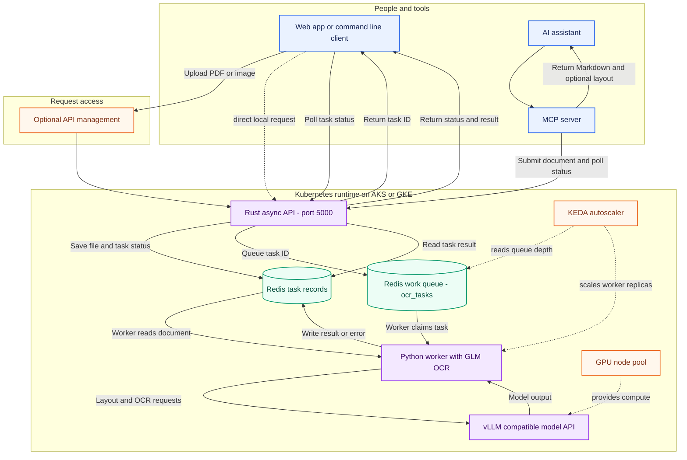
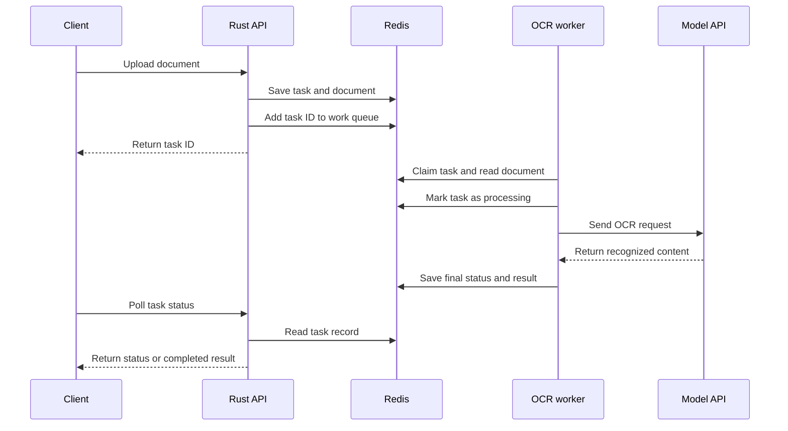
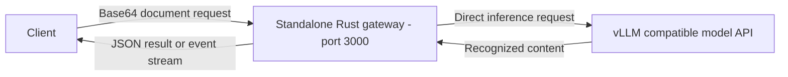

# DocuStream OCR Engineering

**A hands-on document understanding system built around asynchronous OCR, model serving, and cloud deployment.**

Created and maintained by **Abel Adamu Buba** · [abelphedia.com](https://www.abelphedia.com)

> This repository is my adaptation and extension of ideas and source code from [The Neural Maze production OCR course](https://theneuralmaze.substack.com/) and its [open-source repository](https://github.com/neural-maze/production-ocr-course). The original project and course are credited below. My changes include the repository restructure, project documentation, and diagrams; this attribution does not claim authorship of the upstream work.

## What this project does

DocuStream accepts a PDF or image through a Rust API, places the task in Redis, and lets a Python worker process it with GLM-OCR and a configured visual language model. The worker stores the OCR output in Redis for the client to retrieve. Optional components expose the pipeline to AI assistants through MCP and support Kubernetes deployment on AKS or GKE.

The repository also includes a separate synchronous Rust document gateway. It sends document content directly to a compatible model endpoint and can return a JSON response or stream progress with server-sent events.

## System diagrams

### Asynchronous OCR request and result flow

These diagrams were written for this repository from the implemented API routes, Redis task fields, worker behavior, and deployment manifests.





The main asynchronous route is `POST /process` → Redis → worker → model endpoint → Redis → `GET /status/{task_id}`. A queued task does not get OCR results until the worker and compatible model endpoint are running. The Kubernetes examples place the worker and model on GPU-capable nodes; KEDA can scale workers using queue depth.

The model name varies by deployment: the week 5/6 Azure manifests configure `Qwen/Qwen3.5-2B`, while the shared inference entrypoint defaults to `Qwen/Qwen3.5-4B`.

### Separate synchronous gateway

`services/rust-document-gateway` is an alternate path, not a component in the Redis queue flow. It accepts a Base64 document in a JSON request, processes it directly through a vLLM-compatible endpoint, and returns JSON or server-sent events.



## Repository layout

```text
deployments/azure/       Milestone deployment guides, worker, and Kubernetes manifests
docs/                    Azure/GCP onboarding, GPU prerequisites, and deployment guides
docs/images/             Images retained from the upstream project; see NOTICE
infrastructure/gcp/      GKE Terraform configuration
infrastructure/kubernetes/ Shared AKS and GKE manifests
services/gateway/        Rust async upload API backed by Redis
services/inference/      vLLM container entrypoint and requirements
services/mcp/             MCP server for submitting and polling OCR jobs
services/rust-document-gateway/  Standalone synchronous Rust gateway
```

The Python worker implementation and its configuration are in each Azure milestone deployment folder, for example [week 5 worker](deployments/azure/week-05-async-pipeline/client_rt_consumer/worker.py).

## Run the local API and submit a document

This starts Redis and the upload API. It verifies upload and queueing; OCR processing still requires the Python worker and a compatible model service.

1. Start Docker Desktop and open **Developer PowerShell for Visual Studio**.
2. From the repository root, start Redis (if the container already exists, use `docker start docustream-redis`):

   ```powershell
   docker run -d --name docustream-redis -p 6379:6379 redis:7-alpine
   ```

3. In the same shell, configure Redis and start the API:

   ```powershell
   $env:REDIS_HOST = "localhost"
   cargo run --manifest-path services/gateway/Cargo.toml
   ```

4. In a second PowerShell window, upload a PDF or image (the API request limit is 10 MB):

   ```powershell
   $file = "C:\path\to\document.pdf"
   $response = curl.exe -sS -X POST "http://localhost:5000/process" -F "file=@$file" | ConvertFrom-Json
   $response
   ```

5. Check the task status using the returned ID:

   ```powershell
   Invoke-RestMethod "http://localhost:5000/status/$($response.task_id)"
   ```

Without the worker and model service, the status remains `queued`. See the [week 5 async pipeline guide](deployments/azure/week-05-async-pipeline/README.md) and [week 6 integration guide](deployments/azure/week-06-api-gateway-mcp/README.md) for cloud deployment details.

## Learning path

| Milestone | Engineering focus | Guide |
| --- | --- | --- |
| 1–2 | Kubernetes/GPU foundations and document understanding | [Azure and GCP guides](docs/azure_onboarding.md) · [OCR approaches](docs/cloud_comparison.md) |
| 3 | vLLM inference serving | [Week 3](deployments/azure/week-03-vllm-inference/README.md) |
| 4 | Rust document gateway | [Week 4](deployments/azure/week-04-rust-gateway/README.md) |
| 5 | Redis queue and asynchronous worker | [Week 5](deployments/azure/week-05-async-pipeline/README.md) |
| 6 | API gateway and MCP integration | [Week 6](deployments/azure/week-06-api-gateway-mcp/README.md) |

## Credits and licensing

The course and upstream implementation that informed this repository are by [The Neural Maze](https://theneuralmaze.substack.com/), including its [production OCR course repository](https://github.com/neural-maze/production-ocr-course). The source repository identifies its license as Apache-2.0. This repository retains that license and includes upstream-derived code and images alongside my modifications. See [NOTICE](NOTICE) for attribution. This credit identifies the source; it does not imply endorsement by the upstream authors.

I own the original contributions I created for this repository, subject to the repository's Apache-2.0 license and the rights in upstream material. Taking the course alone would not transfer ownership of the course materials or source code; this project relies on the upstream repository's open-source license for reuse.
