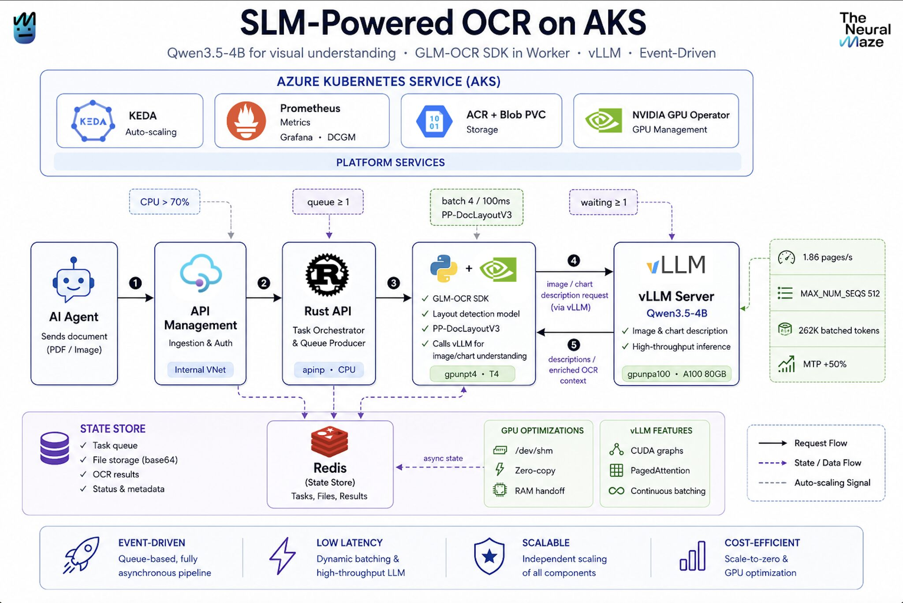
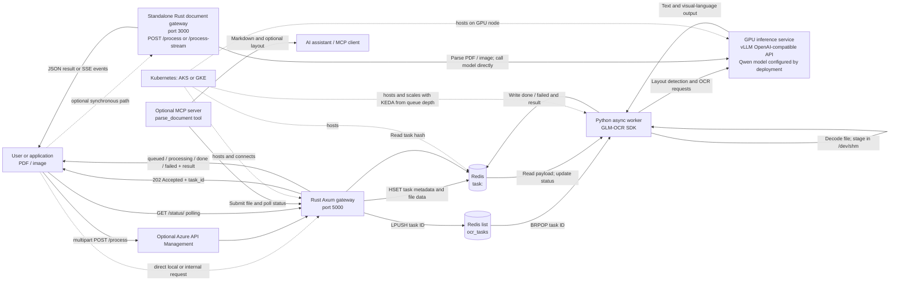
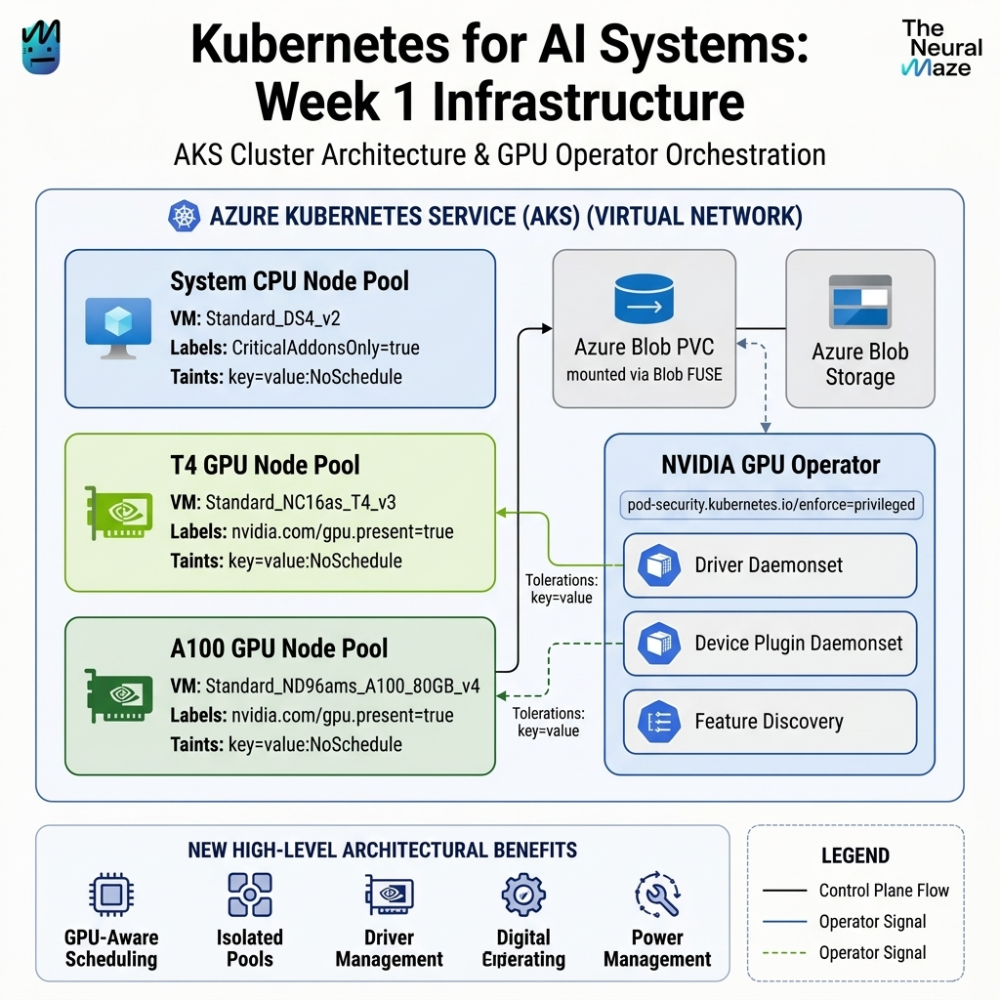
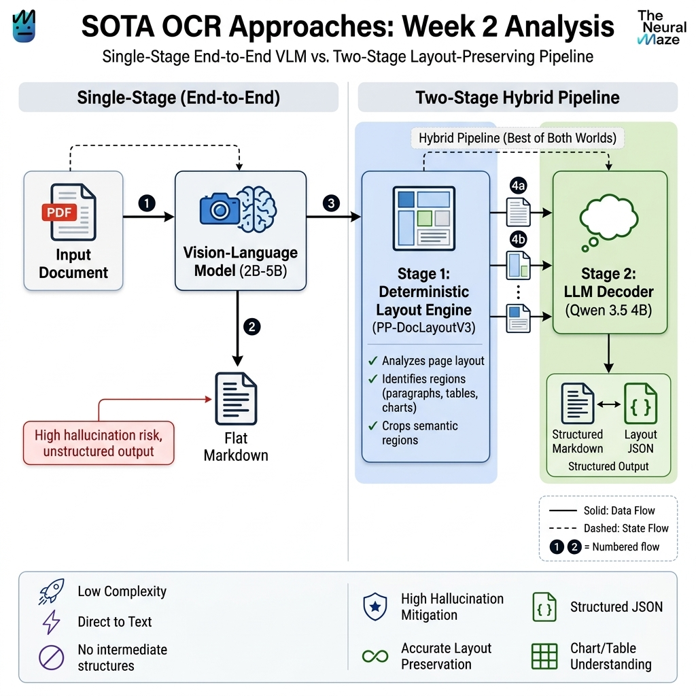
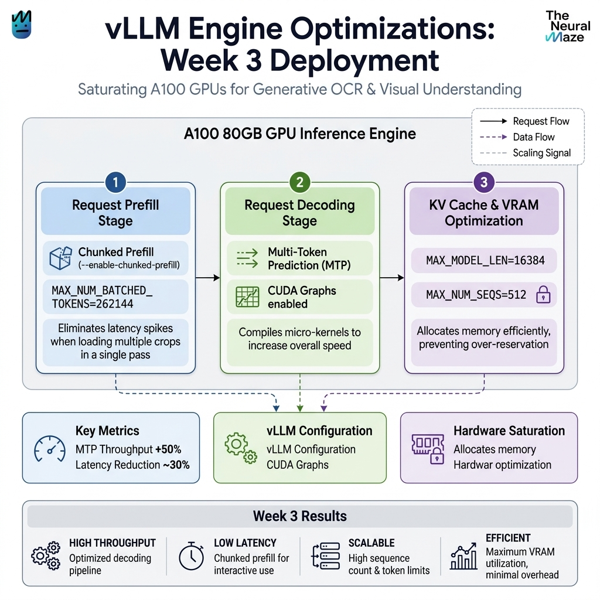
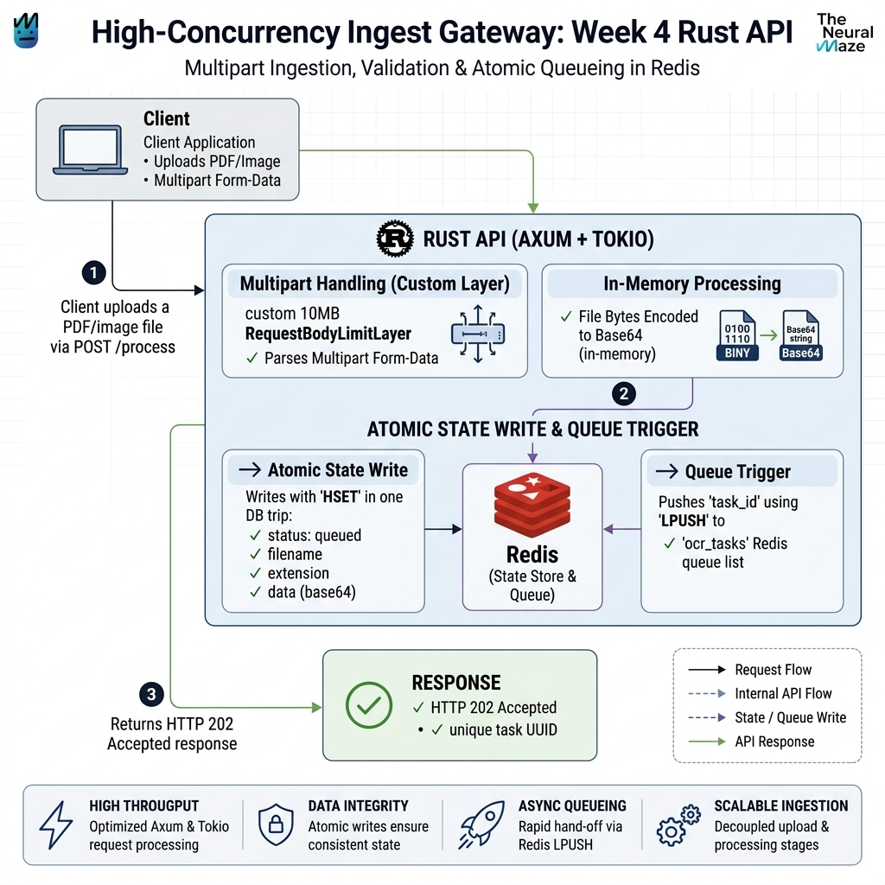
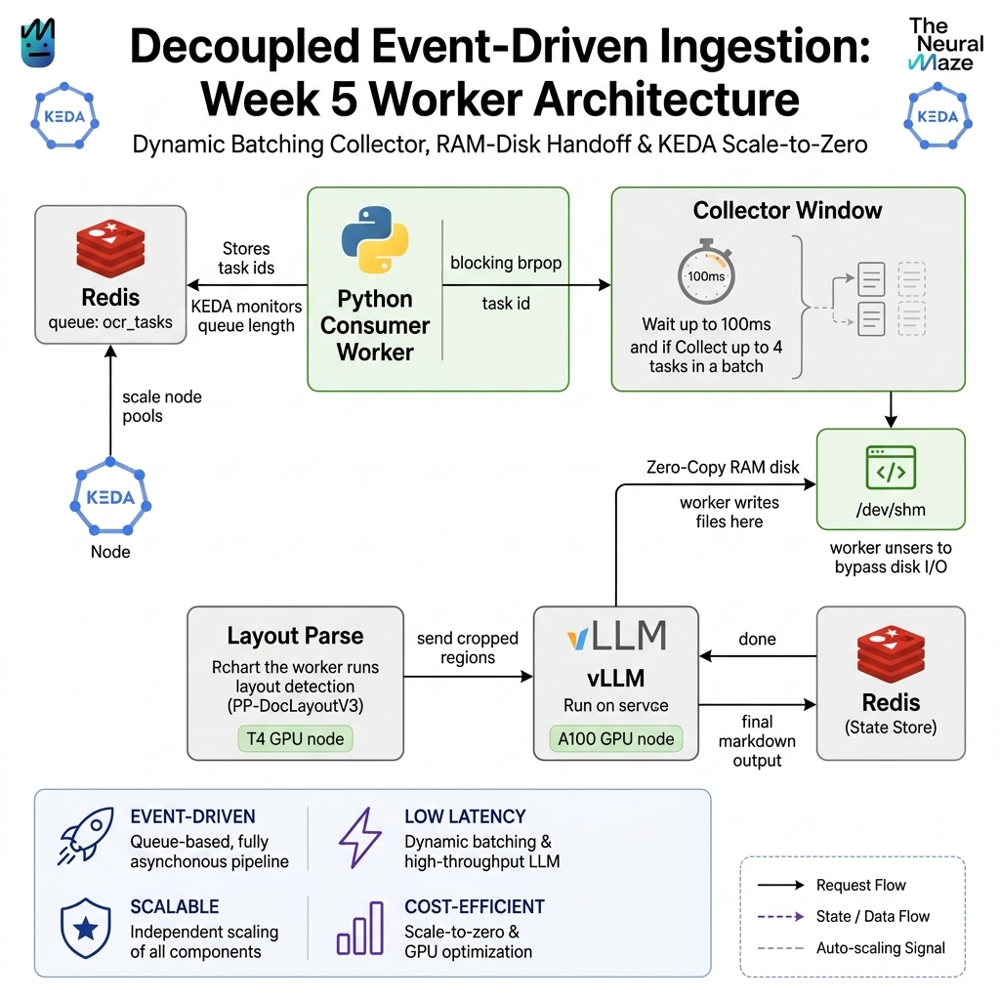
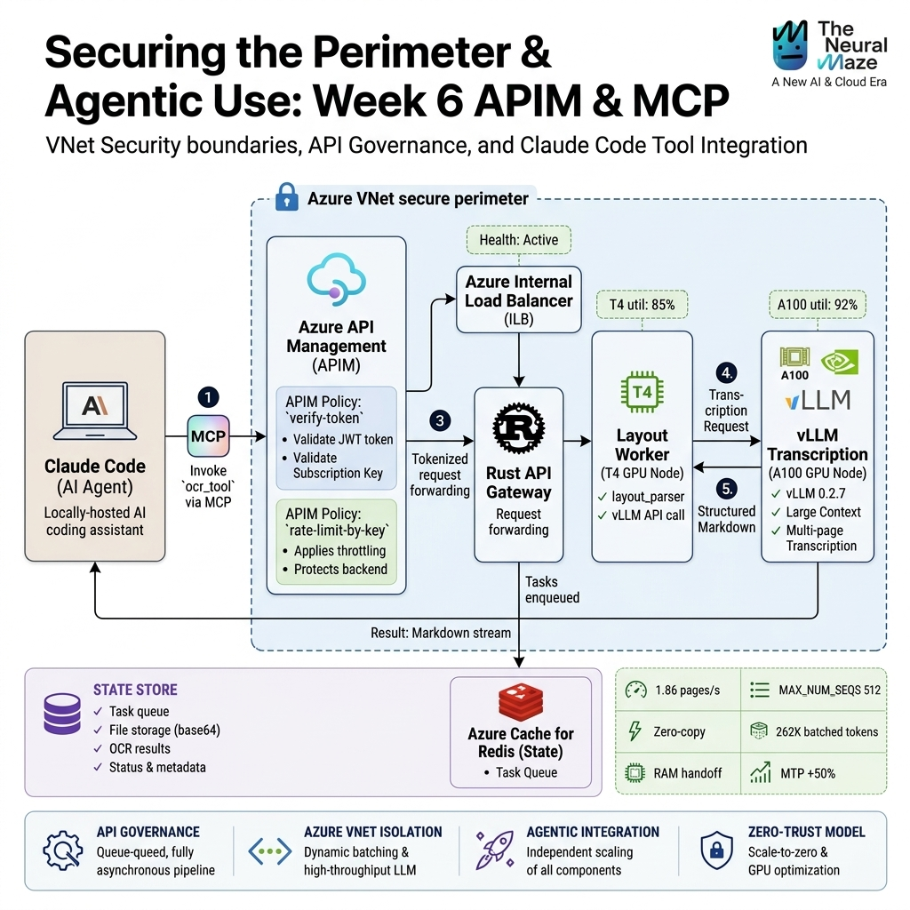

# DocuStream OCR Engineering

**A practical course in building, scaling, and securing a production document-understanding pipeline.**

DocuStream OCR Engineering follows a document from upload to structured output. The project brings together visual document understanding, GPU inference, cloud infrastructure, asynchronous processing, and agent-ready interfaces. It is organized as six hands-on learning milestones, with Azure AKS and Google GKE deployment material.

<p align="center">
  
</p>

## About this project

I’m **Abel Adamu Buba**, and I built this project by studying and reworking ideas from a course I took through [The Neural Maze](https://theneuralmaze.substack.com/). The course was the inspiration and learning reference for this project; the reorganized repository, project presentation, and further changes are my own work. Please credit The Neural Maze when referring to the source course.

- Website: [abelphedia.com](https://www.abelphedia.com)
- Source-course credit: [The Neural Maze](https://theneuralmaze.substack.com/)

## What you’ll build

An OCR and visual document-understanding system that accepts PDF and image uploads, queues work in Redis, analyzes page layout, sends document content to a model-serving engine, and returns structured results. The course explores deployment patterns for GPU-backed Kubernetes workloads and controlled API access.

### Learning path

| Milestone | Focus | Main topics |
| --- | --- | --- |
| 1. Cloud and GPU foundations | Kubernetes for AI workloads | AKS/GKE, node pools, GPU scheduling, storage, and quotas |
| 2. Document understanding | OCR and visual layout | Layout-first processing, document regions, tables, and model tradeoffs |
| 3. Inference serving | vLLM | Containerized model serving, batching, GPU configuration, and autoscaling |
| 4. Document gateway | Rust and Axum | Upload handling, request limits, PDF processing, and a fast API gateway |
| 5. Asynchronous processing | Redis and Python | Producers, workers, batching, shared-memory handoff, and KEDA |
| 6. Secure integrations | API gateways and MCP | APIM, policy controls, and exposing the pipeline as an MCP tool |

## Repository map

```text
.
├── deployments/
│   └── azure/                 # Milestone deployment walkthroughs and manifests
├── docs/                      # Cloud guides, architecture notes, and diagrams
│   └── images/
├── infrastructure/
│   ├── gcp/                   # GKE Terraform project
│   └── kubernetes/            # Shared AKS and GKE manifests
├── services/
│   ├── gateway/               # Rust asynchronous upload API
│   ├── inference/              # vLLM container setup
│   ├── mcp/                    # MCP server integration
│   ├── rust-document-gateway/ # Standalone Rust document-processing gateway
│   └── worker/                 # Python Redis consumer
└── README.md
```

### Milestone guides

- [03 — vLLM inference on AKS](deployments/azure/week-03-vllm-inference/README.md)
- [04 — Rust document gateway on AKS](deployments/azure/week-04-rust-gateway/README.md)
- [05 — Asynchronous OCR pipeline on AKS](deployments/azure/week-05-async-pipeline/README.md)
- [06 — API gateway and MCP integration on AKS](deployments/azure/week-06-api-gateway-mcp/README.md)

The guides build on one another. Start with [Azure onboarding](docs/azure_onboarding.md), review [GPU prerequisites](docs/azure_gpu_prereqs.md), and follow the [AKS deployment guide](docs/aks_deployment.md). For Google Cloud, start with [GCP onboarding](docs/gcp_onboarding.md), [GCP GPU prerequisites](docs/gcp_gpu_prereqs.md), and the [GKE deployment guide](docs/gke_deployment.md). The [provider comparison](docs/cloud_comparison.md) describes differences between the two.

## Course diagrams

### End-to-end system flow

The diagram below shows the request path, asynchronous processing path, and optional MCP/API-management integrations. The Rust gateway and Redis can accept and queue work independently; a running OCR worker and model service are required to produce results.



**Request lifecycle:** the gateway stores the uploaded file and task metadata in a Redis hash, pushes the task ID onto `ocr_tasks`, and returns a task ID. The worker consumes tasks, runs GLM-OCR layout/document processing, and calls the configured vLLM endpoint for model inference. It writes the result or error back to Redis. The client polls `/status/{task_id}` to retrieve it. MCP wraps the same submit-and-poll API for AI assistants. Kubernetes manifests provide the cloud deployment; KEDA can scale workers based on queued tasks.

The standalone `services/rust-document-gateway` is a separate synchronous option: it accepts a Base64 document in JSON and calls the vLLM-compatible endpoint directly, returning JSON or server-sent events without using Redis or the Python worker. Its default model ID is `baidu/Unlimited-OCR`. In the asynchronous pipeline, the model name is a deployment setting: the week 5/6 Azure examples configure **Qwen/Qwen3.5-2B**, while the shared inference entrypoint defaults to **Qwen/Qwen3.5-4B**. The API and queue flow do not themselves run OCR; results require the worker and a compatible model endpoint.

<p align="center">
  
  
  
</p>
<p align="center">
  
  
  
</p>

## Before deploying

The GPU-backed examples can incur substantial cloud charges and require GPU quota. Read the provider onboarding and GPU prerequisite guides before provisioning resources. Review each milestone Makefile and its guide before running cloud commands; set your own account, region, registry, and cluster values.

The course explores architecture patterns and example configurations. Throughput, model performance, cloud availability, security requirements, and costs depend on the models and environment you choose; validate them for your deployment.

## Credits and license

The learning idea and course reference are credited to [The Neural Maze](https://theneuralmaze.substack.com/). This repository is my independent learning project and refactor by **Abel Adamu Buba**. The repository is provided under the [MIT License](LICENSE); see that file for the applicable terms.
